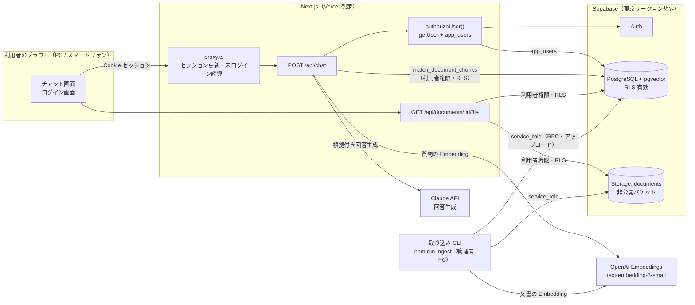
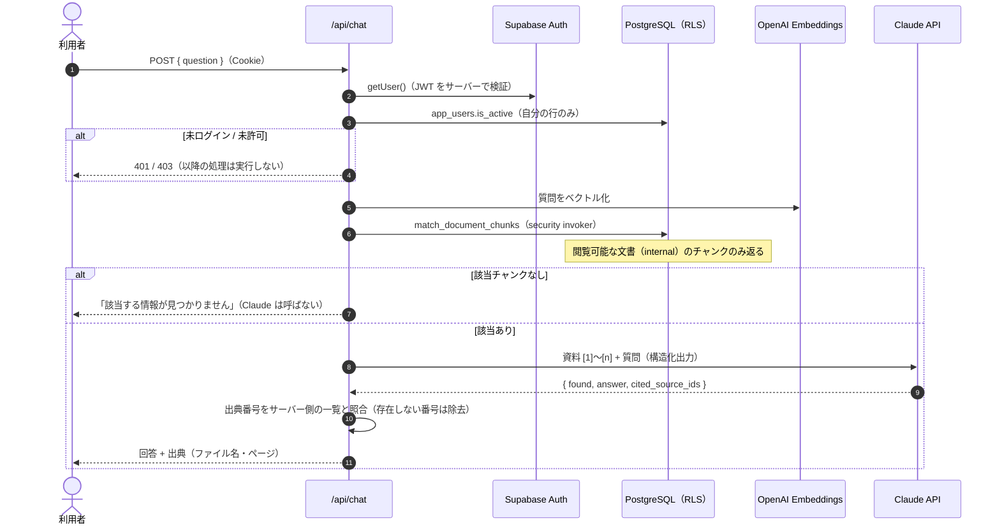
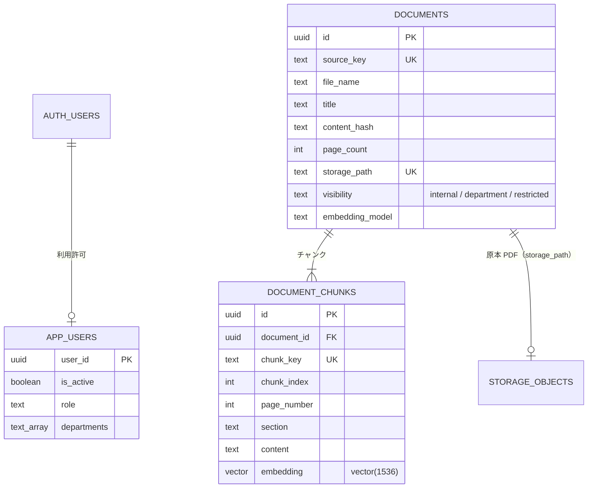

# アーキテクチャ・共通仕様

この文書と `src/lib/contracts/`・`supabase/migrations/` が、システム共通の仕様です。
共通部分を変える場合は **main で変更してから各ブランチへマージ** します（feature ブランチで直接書き換えない）。

## システム構成図



## 質問応答のシーケンス



## データモデル



## 処理の概要（テキスト版）

```
[ブラウザ] ──(Cookie セッション)──> [Next.js Route Handler]
                                     │ 1. authorizeUser()  … getUser + app_users で認可
                                     │ 2. EmbeddingProvider.embed(question)
                                     │ 3. ChunkSearcher.search() … ユーザー権限の Supabase クライアントで RPC（RLS 適用）
                                     │ 4. AnswerGenerator.generate() … Claude（構造化出力）
                                     │ 5. 出典 ID をサーバー側の一覧と照合し Citation を生成
                                     ▼
                                  ChatResponse
[取り込み CLI (npm run ingest)] ── service_role ──> documents / document_chunks / Storage(非公開)
```

## ファイルの担当（競合回避のため、担当外のファイルは原則変更しない）

| 領域 | ブランチ | 担当ファイル |
| --- | --- | --- |
| 共通 | main | `src/lib/contracts/**`, `src/lib/config/**`, `src/lib/auth/**`（`server.ts` に `authorizeWithSupabase()` アダプタ）, `src/lib/supabase/**`, `src/lib/embeddings/**`, `src/lib/observability/**`, `src/lib/documents/{csv,normalize,pdf}.ts`, `supabase/migrations/20261122000000_rag_schema.sql`, `docs/ARCHITECTURE.md` |
| A 取り込み | feature/ingest | `src/lib/ingest/**`, `scripts/ingest.ts`, `supabase/migrations/2026112200010*_*.sql`, `docs/INGEST.md` |
| B 検索・回答 | feature/search | `src/lib/search/**`, `src/lib/answer/**`, `src/app/api/chat/**`, `docs/SEARCH.md` |
| C UI・認証 | feature/ui | `src/app/(auth)/**`, `src/app/(chat)/**` or `src/app/page.tsx`, `src/app/layout.tsx`, `src/app/globals.css`, `src/components/**`, `src/proxy.ts`, `src/app/auth/**`, `src/app/api/documents/**`, `docs/UI.md` |

`package.json` / `package-lock.json` は共通依存を main で導入済み。feature ブランチで依存を追加する必要がある場合は最小限にし、報告すること。

## データ形式

- `sourceKey`: ファイル名から拡張子を除いたもの（例 `demo-doc1-travel-rules`）。`documents.source_key` は一意。
- `chunkKey`: `${sourceKey}:p${pageNumber}:c${chunkIndex}`。`document_chunks.chunk_key` は一意。
- ページ番号は **1 始まり**。PDF の物理ページ番号と一致させる（`#page=N` でそのまま開ける）。
- 本文は `normalizeText()`（NFKC）で正規化してから保存・Embedding する。
- 出典（`Citation`）はサーバーが `RetrievedChunk` から生成する。LLM には `[1]`〜`[n]` の番号だけを渡し、
  LLM が返した番号のうち **今回渡した一覧に存在するものだけ** を採用する（存在しない出典を作らせない）。
- 根拠がない・しきい値を超えるチャンクがない・LLM が根拠なしと判断した場合は
  `{ answer: NOT_FOUND_MESSAGE, found: false, citations: [] }` を返す。

## API

| メソッド・パス | 説明 | 認証 | 主なステータス |
| --- | --- | --- | --- |
| `POST /api/chat` | 質問 → 回答・出典 | 必須 | 200 / 400 / 401 / 403 / 413 / 500 / 503 |
| `GET /api/documents/{documentId}/file` | 出典 PDF（`#page=N` で該当ページ） | 必須 | 200 / 401 / 403 / 404 |

- リクエスト・レスポンスの型は `src/lib/contracts/api.ts`（zod）を参照。
- エラーは `apiErrorResponse(code)` で `{ error: { code, message } }` 形式。内部情報は返さない。
- 権限のない文書と存在しない文書は、どちらも **404** を返して区別させない。
- すべての API レスポンスは `Cache-Control: no-store`。

## 認証・認可

- `authorizeUser(supabase, getAuthConfig())` を **すべての API の最初** に呼ぶ（`src/lib/auth/authorize.ts`）。
  - `getUser()` で JWT をサーバー検証 → メール確認済み → （設定時）許可ドメイン完全一致 → `app_users.is_active`。
  - メールドメインの一致だけでは認可しない。
- `proxy.ts` はセッション更新と未ログイン時のリダイレクト（楽観的チェック）のみ。認可の最終判断は各 Route Handler / Server Component で行う。
- service_role キーは `src/lib/supabase/admin.ts` 経由で **取り込み CLI のみ** が使う。リクエスト処理では使用禁止。

## DB（`supabase/migrations/20261122000000_rag_schema.sql`）

- `app_users`（利用許可）、`documents`、`document_chunks`（`vector(1536)`、HNSW cosine）。
- RLS 有効。読み取りは `authenticated` かつ `is_active_app_user()` かつ `visibility = 'internal'` の文書のみ。
  `department` / `restricted` は MVP ではどのポリシーでも許可しない。
- `match_document_chunks(query_embedding, match_threshold, match_count)` は `security invoker`（RLS を迂回しない）。
- Storage バケット `documents` は非公開。読み取りは閲覧可能な文書の `storage_path` に一致するオブジェクトのみ。

## ログ

- `logError(context, error)`（`src/lib/observability/log.ts`）を使い、エラーの種類だけを記録する。
- 質問文・文書本文・回答・API キー・トークン・メールアドレスをログに出さない。

## テスト方針

- 外部 API（OpenAI / Anthropic）と Supabase はすべてモック。実キー・実 DB には接続しない。
- `MockEmbeddingProvider`（決定的）を検索・取り込みのテストに使う。
- Route Handler はファクトリ関数（依存注入）で実装し、テストではモック依存を渡す。
